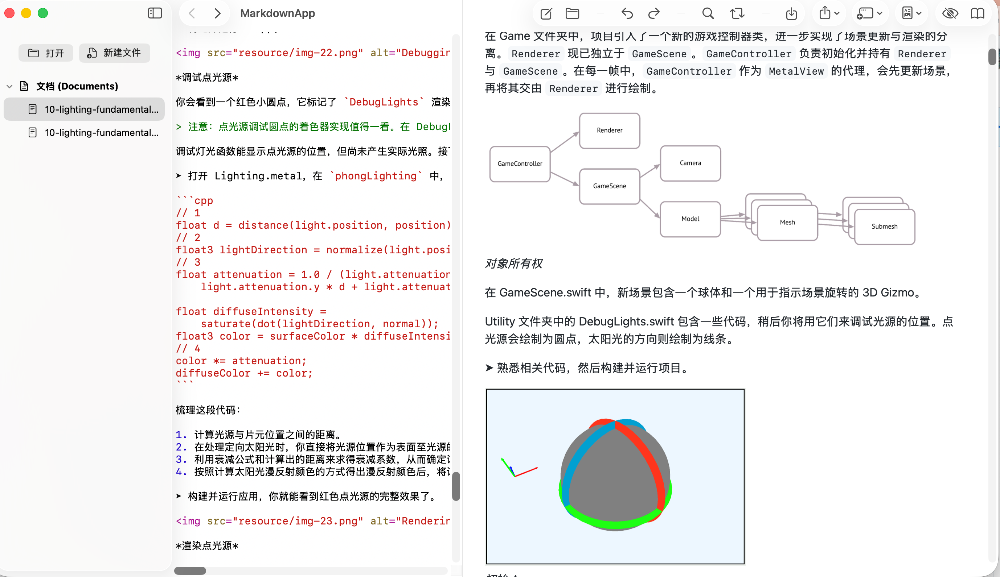

# MarkdownApp

[English](#english) | [中文](#中文)



## 中文

MarkdownApp 是一个使用 SwiftUI 构建的原生 Markdown 编辑器与阅读器，支持 macOS 和 iOS。它将编辑、实时预览和文件管理整合在一个轻量级应用中。

### 功能

- 编辑器语法高亮，提供多种配色主题。
- 实时 Markdown 预览，支持代码高亮、Mermaid 图表和图片点击放大。
- 支持本地相对路径图片，按当前 Markdown 文件所在目录解析。
- 文件与文件夹打开、新建、保存、另存为、重命名和删除。
- macOS 分栏编辑/预览、阅读模式，以及上一个/下一个文档导航。
- 搜索与替换、撤销与重做。
- 可调整编辑器主题、预览主题、字体大小、行高、自动换行和背景颜色。
- 导出为 HTML 或 PDF（PDF 导出目前支持 macOS）。

### 环境要求

- Xcode（项目使用 Swift Package Manager 自动解析依赖）。
- macOS 15.6+ 或 iOS 18.6+。

### 构建与运行

1. 克隆仓库：

   ```bash
   git clone https://github.com/liu6x6/MarkdownApp.git
   cd MarkdownApp
   ```

2. 使用 Xcode 打开 `MarkdownApp.xcodeproj`。
3. 选择 `MarkdownApp`（macOS）或 `MarkdownApp_iOS`（iOS）scheme。
4. 选择运行目标并按 <kbd>⌘R</kbd>。

### 常用快捷键（macOS）

| 操作 | 快捷键 |
| --- | --- |
| 新建文档 | <kbd>⌘N</kbd> |
| 打开文件或文件夹 | <kbd>⌘O</kbd> |
| 保存 | <kbd>⌘S</kbd> |
| 另存为 | <kbd>⇧⌘S</kbd> |
| 撤销 / 重做 | <kbd>⌘Z</kbd> / <kbd>⇧⌘Z</kbd> |
| 搜索 / 替换 | <kbd>⌘F</kbd> / <kbd>⌘R</kbd> |
| 上一个 / 下一个文档 | <kbd>⌘[</kbd> / <kbd>⌘]</kbd> |

### 依赖

- [Highlightr](https://github.com/raspu/Highlightr)
- [swift-markdown](https://github.com/apple/swift-markdown)
- [swift-cmark](https://github.com/swiftlang/swift-cmark)

## English

MarkdownApp is a native Markdown editor and reader built with SwiftUI for macOS and iOS. It combines editing, live preview, and file management in a lightweight application.

### Features

- Syntax-highlighted editor with multiple color themes.
- Live Markdown preview with code highlighting, Mermaid diagrams, and click-to-expand images.
- Local relative images resolved from the directory of the current Markdown file.
- Open files or folders; create, save, save as, rename, and delete documents.
- macOS split editor/preview, reading mode, and previous/next document navigation.
- Find and replace, undo, and redo.
- Configurable editor and preview themes, font size, line height, word wrapping, and background color.
- Export to HTML or PDF (PDF export is currently available on macOS).

### Requirements

- Xcode; dependencies are resolved automatically with Swift Package Manager.
- macOS 15.6+ or iOS 18.6+.

### Build and Run

1. Clone the repository:

   ```bash
   git clone https://github.com/liu6x6/MarkdownApp.git
   cd MarkdownApp
   ```

2. Open `MarkdownApp.xcodeproj` in Xcode.
3. Select the `MarkdownApp` (macOS) or `MarkdownApp_iOS` (iOS) scheme.
4. Choose a destination and press <kbd>⌘R</kbd>.

### Keyboard Shortcuts (macOS)

| Action | Shortcut |
| --- | --- |
| New document | <kbd>⌘N</kbd> |
| Open file or folder | <kbd>⌘O</kbd> |
| Save | <kbd>⌘S</kbd> |
| Save as | <kbd>⇧⌘S</kbd> |
| Undo / Redo | <kbd>⌘Z</kbd> / <kbd>⇧⌘Z</kbd> |
| Find / Replace | <kbd>⌘F</kbd> / <kbd>⌘R</kbd> |
| Previous / Next document | <kbd>⌘[</kbd> / <kbd>⌘]</kbd> |

### Dependencies

- [Highlightr](https://github.com/raspu/Highlightr)
- [swift-markdown](https://github.com/apple/swift-markdown)
- [swift-cmark](https://github.com/swiftlang/swift-cmark)
